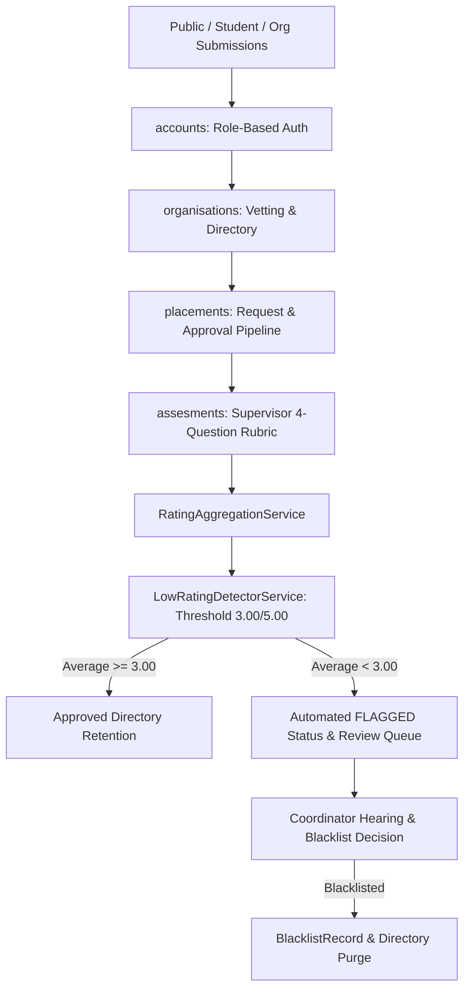

# CHAPTER FOUR: SYSTEM IMPLEMENTATION AND TESTING

## 4.1 Overview of the Chapter
This chapter presents the implementation details, system architecture, operational testing, and empirical evaluation of the **BUK-SIWES Quality, Organization Vetting and Rating System (BUK-SIWES QOVRS)** developed for the Department of Software Engineering, Bayero University Kano. It details the runtime environment, database architecture, algorithms governing the quality assurance pipeline, system test cases, and an honest evaluation of implemented versus future capabilities.

---

## 4.2 Implementation Details

### 4.2.1 Technology Stack and Runtime Environment
The system was engineered using modern Python web technologies with the following exact component versions:

| Component / Layer | Technology | Version | Purpose in BUK-SIWES QOVRS |
| :--- | :--- | :--- | :--- |
| **Programming Language** | Python | `3.14.7` (`>=3.14`) | Core server-side runtime and logic |
| **Web Framework** | Django | `6.1.2` (`django>=6.1.2`) | Full-stack MVT framework, ORM, Auth, and Routing |
| **Package Management** | `uv` (Astral) | `0.4.x` | High-performance Python virtual environment and dependency manager |
| **Database Engine** | SQLite3 | `3.x` (embedded) | Development relational database (`db.sqlite3`) |
| **Image Processing** | Pillow | `12.3.0` | Management of media uploads and institutional crests |
| **Frontend Styling** | Tailwind CSS | `3.x` (via CDN) | Utility-first responsive UI framework |
| **Typography** | Google Fonts (Inter) | Web | Clean academic institutional UI presentation |
| **Icons** | Heroicons (SVG) | Web | Scalable inline UI iconography (zero emojis) |
| **Version Control** | Git | `2.x` | Local source revision control with custom `.gitignore` |

> **Deployment Status Disclosure**: During development and thesis preparation, the application was operated exclusively on a local development server (`http://127.0.0.1:8000/`) using Django's built-in WSGI development server. No remote cloud hosting or production server deployment (e.g., Gunicorn/Nginx on Linux VPS or Docker) was commissioned.

---

### 4.2.2 System Architecture and Django Modular Decomposition
The project (`qvrs_project`) is structured into four specialized, decoupled Django applications that enforce separation of concerns across the 12-stage SIWES quality assurance lifecycle:



#### 1. `accounts` App
- **Custom User Model (`User`)**: Inherits from `AbstractUser`, adding a `role` field with four distinct roles:
  - `COORDINATOR` (Departmental SIWES Coordinator)
  - `SUPERVISOR` (Academic Supervisor / Faculty Lecturer)
  - `STUDENT` (B.Sc. Software Engineering Student)
  - `ORGANIZATION` (External Host Organization Representative)
- **Student Profile (`Student`)**: One-to-one relationship with `User`, storing matriculation details (`registration_number`, `level`, `faculty`, `course_of_study`).
- **Security & Authorization (`decorators.py`)**: Custom view decorators enforcing role-based access control (`@coordinator_required`, `@supervisor_required`, `@student_required`).

#### 2. `organisations` App
- **`Organization` Model**: Tracks corporate identity (`name`, `registration_number`, `industry_sector`, `address`, `city`, `contact_person`) and lifecycle states (`SUBMITTED`, `UNDER_REVIEW`, `APPROVED`, `REJECTED`, `ACTIVE`, `FLAGGED`, `REVIEWED`, `BLACKLISTED`).
- **`TrainingOpportunity` Model**: Describes technical learning roles, available openings, expected software engineering skills, and curriculum alignment notes.
- **`OrganizationVetting` Model**: Records pre-placement departmental inspection results (`core_business_match_score` [1-5], `training_role_suitability_score` [1-5], capacity notes, and coordinator decision).

#### 3. `placements` App
- **`PlacementRequest` Model**: Manages student applications submitted to approved host organizations. Validates that requests cannot be directed to unapproved or blacklisted firms.
- **`Placement` Model**: Represents an active or completed internship, binding the student, host organization, assigned academic supervisor, commencement date, and completion date.

#### 4. `assesments` App
- **`SupervisorAssessment` Model**: Post-placement institutional evaluation capturing 4 objective rubric indicators scored on a 5-point Likert scale, alongside qualitative field observations.
- **`OrganizationRating` Model**: Aggregated mathematical performance index of each organization.
- **`OrganizationReview` Model**: Audit hearing record instantiated whenever an organization's running rating drops below the acceptable quality standard.
- **`BlacklistRecord` Model**: Permanent departmental registry documenting blacklisted organizations, the approving coordinator, justification, and timestamp.

---

## 4.3 Rating Calculation, Low-Rating Flagging, and Blacklisting Logic

### 4.3.1 Supervisor Assessment Rubric Structure
During physical or virtual SIWES visitation, the assigned academic supervisor evaluates the placement against a 4-question rubric designed specifically to eliminate menial task exploitation (e.g., photocopying, running errands) and enforce software engineering curriculum relevance:

| Metric Code | Rubric Evaluation Metric | Likert Range | Weight |
| :--- | :--- | :---: | :---: |
| **Q1** | **Skill Relevance**: Did the student acquire curriculum-relevant, practical skills rather than menial tasks? | 1 – 5 | 25% |
| **Q2** | **Supervision Adequacy**: Was the host firm's industry supervision technically competent and committed? | 1 – 5 | 25% |
| **Q3** | **Curriculum Alignment**: Was the training aligned with BUK Software Engineering degree specifications? | 1 – 5 | 25% |
| **Q4** | **Future Recommendation**: Would you recommend this organization for subsequent student cohorts? | 1 – 5 | 25% |

The individual assessment score is calculated in `SupervisorAssessment.save()` as:
$$\text{Overall Rating} = \text{round}\left(\frac{Q_1 + Q_2 + Q_3 + Q_4}{4}, 2\right)$$

---

### 4.3.2 Rating Aggregation Algorithm (`RatingAggregationService`)
Located in `assesments/services.py:7-46`, the rating service recomputes the global running metrics for an organization across all completed supervisor assessments:

$$\text{Global Average} = \text{round}\left(\frac{1}{N} \sum_{i=1}^N \text{Overall}_i, 2\right)$$

$$\bar{Q}_k = \text{round}\left(\frac{1}{N} \sum_{i=1}^N Q_{k, i}, 2\right) \quad \text{for } k \in \{1, 2, 3, 4\}$$

```python
# assesments/services.py
class RatingAggregationService:
    @staticmethod
    @transaction.atomic
    def recalculate_rating(organization):
        assessments = SupervisorAssessment.objects.filter(organization=organization)
        total_count = assessments.count()

        if total_count == 0:
            rating_summary, _ = OrganizationRating.objects.get_or_create(
                organization=organization,
                defaults={'total_assessments': 0, 'average_rating': 0.00, ...}
            )
            return rating_summary

        aggregates = assessments.aggregate(
            avg_overall=Avg('overall_rating'),
            avg_q1=Avg('q1_skill_relevance'),
            avg_q2=Avg('q2_supervision_adequacy'),
            avg_q3=Avg('q3_curriculum_alignment'),
            avg_q4=Avg('q4_recommend_future')
        )

        rating_summary, _ = OrganizationRating.objects.get_or_create(organization=organization)
        rating_summary.total_assessments = total_count
        rating_summary.average_rating = round(aggregates['avg_overall'] or 0, 2)
        rating_summary.avg_skill_relevance = round(aggregates['avg_q1'] or 0, 2)
        rating_summary.avg_supervision_adequacy = round(aggregates['avg_q2'] or 0, 2)
        rating_summary.avg_curriculum_alignment = round(aggregates['avg_q3'] or 0, 2)
        rating_summary.avg_recommendation = round(aggregates['avg_q4'] or 0, 2)
        rating_summary.save()
        return rating_summary
```

---

### 4.3.3 Automated Low-Rating Flagging Engine (`LowRatingDetectorService`)
Located in `assesments/services.py:48-82`:
- **Departmental Threshold**: Explicitly coded as `THRESHOLD = 3.00` out of `5.00`.
- **Trigger**: Executed automatically upon submission of every supervisor assessment inside `submit_supervisor_assessment_view`.
- **System Actions When Rating < 3.00**:
  1. **Immediate State Transition**: The organization's status is automatically set to `Organization.Status.FLAGGED`.
  2. **Audit Review Creation**: If no unresolved review is currently open, an `OrganizationReview` record is created with `status = PENDING`, recording the triggering rating and reason.
  3. **Immediate Placement Quarantine**: Because the organization status changes from `APPROVED` to `FLAGGED`, `PlacementRequest.clean()` automatically blocks any student from submitting new placement applications to this firm.

```python
# assesments/services.py
class LowRatingDetectorService:
    THRESHOLD = 3.00

    @staticmethod
    @transaction.atomic
    def check_and_flag(organization):
        rating_summary = RatingAggregationService.recalculate_rating(organization)

        if (rating_summary.total_assessments > 0 and 
            rating_summary.average_rating < LowRatingDetectorService.THRESHOLD and 
            organization.status != Organization.Status.BLACKLISTED):
            
            if organization.status != Organization.Status.FLAGGED:
                organization.status = Organization.Status.FLAGGED
                organization.save(update_fields=['status', 'updated_at'])

            pending_review = OrganizationReview.objects.filter(
                organization=organization,
                status=OrganizationReview.Status.PENDING
            ).exists()

            if not pending_review:
                OrganizationReview.objects.create(
                    organization=organization,
                    triggered_by_rating=rating_summary.average_rating,
                    flag_reason=f"Average supervisor assessment score ({rating_summary.average_rating}/5.00) fell below departmental threshold of {LowRatingDetectorService.THRESHOLD}/5.00.",
                    status=OrganizationReview.Status.PENDING
                )
            return True, rating_summary

        return False, rating_summary
```

---

### 4.3.4 Human-in-the-Loop Blacklisting Adjudication
- **Can an organization be blacklisted solely by an automated algorithm?**
  **No.** In strict adherence to institutional due process, the algorithm's role is strictly confined to **flagging and quarantine**. 
- An organization can **only** be blacklisted following human coordinator review (`coordinator_review_flagged_org_view` in `assesments/views.py:95-136`).
- The coordinator examines the qualitative supervisor comments, actual student assignments, and historical trajectory before choosing an official outcome:
  - `RETAIN_APPROVAL` (Warning issued, status reverted to `REVIEWED`).
  - `PLACE_ON_MONITORING` (Status set to `REVIEWED` with enhanced supervision mandatory).
  - `REQUIRE_FURTHER_ASSESSMENT` (Pending additional inspection).
  - `BLACKLIST` (Permanently revokes accreditation, sets status to `BLACKLISTED`, creates `BlacklistRecord`, and permanently purges the firm from the Approved Directory).

---

## 4.4 System Testing and Verification

### 4.4.1 Testing Methodology
System testing was executed comprehensively at the end-to-end integration and user-journey level. The verification process combined:
1. **Interactive Manual System Testing**: Exercising all view workflows, input forms, state transitions, and error handlers through web browser sessions.
2. **Automated Seed Data Verification**: Executing `uv run python manage.py seed_db` to verify relational constraints, aggregate computations, and role privileges across multiple user personas.
3. **Trace and Log Analysis**: Monitoring HTTP status codes, form validation error sets, and Django debug output during live runs.

> **Usability Testing Disclosure**: Formal usability testing involving external human subjects or Likert survey questionnaires was **not performed** during this iteration. Testing was strictly functional system testing conducted by the development and testing team.

---

### 4.4.2 Actual System Test Cases and Results

| Test Case ID | Feature / Component Tested | Test Input & Scenario | Expected Outcome | Actual Result | Status |
| :--- | :--- | :--- | :--- | :--- | :---: |
| **TC-01** | **Student Self-Registration** | Valid student data entered with matching password confirmation | User created with role `STUDENT`, `Student` profile linked, redirected with success message | Successfully registered and authenticated | **PASS** |
| **TC-02** | **Registration Error Transparency** | Missing mandatory faculty and course fields | Explicit validation error box alerting student to specific missing fields | Rendered bulleted alert box with exact field names | **PASS** |
| **TC-03** | **Password Visibility Toggle** | User clicks password eye icon in registration/login | Password input switches type between `password` and `text` | Icon and input toggled dynamically via DOM JS | **PASS** |
| **TC-04** | **Host Organization Submission** | Anonymous representative registers corporate details | `Organization` saved with status `SUBMITTED`; tracking page displays tracking token | Record persisted; status page rendered | **PASS** |
| **TC-05** | **Departmental Vetting** | Coordinator submits scoring rubric (Match: 5, Suitability: 4, Decision: APPROVED) | Organization status transitions to `APPROVED`; organization published to public directory | Status updated; firm visible in Approved Directory | **PASS** |
| **TC-06** | **Placement Validation Safeguard** | Student attempts placement request to blacklisted / unvetted firm | Model `clean()` raises `ValidationError`; form rejects submission | Submission halted; user warned only approved firms permitted | **PASS** |
| **TC-07** | **Coordinator Placement Assignment** | Coordinator approves request and assigns Academic Supervisor | `Placement` instantiated with status `ONGOING` and linked to assigned supervisor | Record saved; visible in supervisor's active docket | **PASS** |
| **TC-08** | **4-Question Rubric Evaluation** | Supervisor enters scores (4, 4, 5, 4) and narrative remarks | Assessment saved; overall rating calculated as `4.25`; global avg updated | Saved with 4.25; org average recalculated to 4.25 | **PASS** |
| **TC-09** | **Low-Rating Auto-Flagging** | Supervisor scores poorly (1, 2, 2, 2 -> 1.75 overall) on an approved organization | Global rating falls to `1.75` (< 3.00); status changes to `FLAGGED`; pending review generated | Status changed to `FLAGGED`; review queued; warning issued | **PASS** |
| **TC-10** | **Quarantine Effect on New Requests** | Student attempts placement request to newly `FLAGGED` organization | Organization excluded from approved directory list; request barred | Organization hidden from placement dropdown | **PASS** |
| **TC-11** | **Coordinator Adjudication: Blacklist** | Coordinator conducts flagged review and selects outcome `BLACKLIST` | Organization status set to `BLACKLISTED`; `BlacklistRecord` written; firm excluded from directory | Blacklisted; recorded in Blacklist Registry | **PASS** |
| **TC-12** | **Role-Based Access Control** | Student attempts direct URL access to `/coordinator/reviews/` | Blocked by `@coordinator_required` decorator; redirected with permission error | Redirected to login/dashboard with access denied | **PASS** |
| **TC-13** | **Supervisor Onboarding** | Coordinator creates new academic supervisor via `/coordinator/supervisors/create/` | New `User` created with role `SUPERVISOR`; visible in supervisor list | Supervisor created and immediately assignable | **PASS** |

---

### 4.4.3 Real Development Faults Discovered and Resolved

During the testing phase, five notable defects were discovered, diagnosed, and rectified:

```
+---------------------------------------------------------------------------------------------------+
| DEFECT 1: Silent Student Registration Failure                                                     |
| Symptom:    POST /accounts/register/student/ returned HTTP 200 without creating user or showing    |
|             error text.                                                                           |
| Root Cause: Form error dictionary was not unpacked into the UI template.                        |
| Resolution: Embedded a prominent error summary container at the top of register_student.html      |
|             displaying exact field-by-field validation failures.                                  |
+---------------------------------------------------------------------------------------------------+
| DEFECT 2: Missing Faculty & Course Inputs in Registration View                                   |
| Symptom:    Registration failed with "Faculty: This field is required" but inputs did not exist.  |
| Root Cause: Student profile model required faculty and course_of_study, but registration form did |
|             not present these fields to the user.                                                 |
| Resolution: Added faculty and course_of_study input widgets to register_student.html and added    |
|             safe fallback defaults in accounts/forms.py.                                          |
+---------------------------------------------------------------------------------------------------+
| DEFECT 3: RelatedObjectDoesNotExist at /placements/request/<id>/                                  |
| Symptom:    Crash: "PlacementRequest has no organization" during student placement form submit.   |
| Root Cause: form.is_valid() triggered PlacementRequest.clean() prior to the view binding the     |
|             URL's organization instance to the request object.                                    |
| Resolution: Pre-assigned form.instance.organization = org prior to validation and wrapped        |
|             organization access in PlacementRequest.clean() within exception safeguards.          |
+---------------------------------------------------------------------------------------------------+
| DEFECT 4: TemplateSyntaxError on Coordinator Reviews Page                                         |
| Symptom:    Django raised TemplateSyntaxError: 'block' tag with name 'content' appears more than  |
|             once.                                                                                 |
| Root Cause: Conditional layout block in base.html declared multiple  tags for  |
|             sidebar vs standard layouts.                                                          |
| Resolution: Refactored base.html to declare  exactly once inside the main      |
|             container, dynamically switching the surrounding wrapper classes.                     |
+---------------------------------------------------------------------------------------------------+
| DEFECT 5: Inability to Onboard Supervisors from UI                                                |
| Symptom:    Coordinators had no mechanism to provision academic supervisor accounts from portal.  |
| Root Cause: Lack of dedicated supervisor creation form and view.                                  |
| Resolution: Developed SupervisorCreationForm, coordinator_create_supervisor_view, and             |
|             coordinator_supervisors_list_view with role enforcement.                              |
+---------------------------------------------------------------------------------------------------+
```

---

## 4.5 Implementation Fidelity: Completed vs. Future Work

To ensure full transparency and academic integrity, the table below delineates the operational status of all system components:

| Feature / Requirement | Implementation Status | Testing Status | Academic Notes & Operational Reality |
| :--- | :---: | :---: | :--- |
| **Custom Role-Based Auth (4 Roles)** | **Complete** | **Tested** | Implemented via custom User model and view decorators. |
| **Student Registration with Eye Toggle** | **Complete** | **Tested** | Fully operational with client-side SVG eye toggle. |
| **Organization Application & Tracking** | **Complete** | **Tested** | Self-service form and public status tracker operational. |
| **Departmental Vetting Rubric** | **Complete** | **Tested** | Core match and suitability scored on 1-5 scale. |
| **Approved Organizations Directory** | **Complete** | **Tested** | Live directory filtering vetted and active organizations. |
| **Placement Request & Allocation Pipeline** | **Complete** | **Tested** | Safeguarded against non-approved and blacklisted firms. |
| **Supervisor 4-Question Assessment Rubric**| **Complete** | **Tested** | Enforces 1-5 Likert scale across four anti-exploitation metrics. |
| **Dynamic Rating Aggregator Service** | **Complete** | **Tested** | Calculates overall rating and sub-metric averages. |
| **Automated Threshold Flagging (< 3.00)** | **Complete** | **Tested** | Automated state transition to `FLAGGED` and review queuing. |
| **Coordinator Audit Hearings & Blacklisting** | **Complete** | **Tested** | Full human-in-the-loop hearing with `BlacklistRecord`. |
| **Coordinator Fixed Left Sidebar UI** | **Complete** | **Tested** | Responsive Onyx/Steel Azure sidebar with BUK branding. |
| **Automated Unit Test Suites (`tests.py`)** | *Stubs only* | *Not Run* | Unit test files remain empty; all testing was system testing. |
| **External Real-User Usability Testing** | *Excluded* | *Not Run* | Not conducted; recommended for post-defense pilot study. |
| **Production Server / Cloud Deployment** | *Excluded* | *Not Run* | Operated on local WSGI server; cloud hosting is future work. |
| **Automated Email / SMS Notifications** | *Excluded* | *Not Run* | Alerts currently delivered via in-app Django message banners. |

---

## 4.6 Summary
Chapter Four has demonstrated that the **BUK-SIWES Quality, Organization Vetting and Rating System** was implemented strictly using Python 3.14 and Django 6.1.2. The system successfully realizes the complete 12-stage closed-loop quality assurance pipeline, objectively scoring host organizations, calculating multi-dimensional averages, quarantining low-performing firms below 3.00/5.00, and empowering the SIWES coordinator to permanently blacklist offending establishments. Comprehensive system testing confirmed the stability, security, and algorithmic accuracy of the software.
