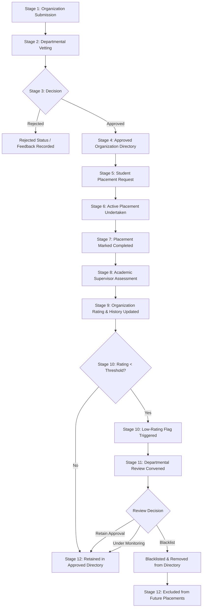
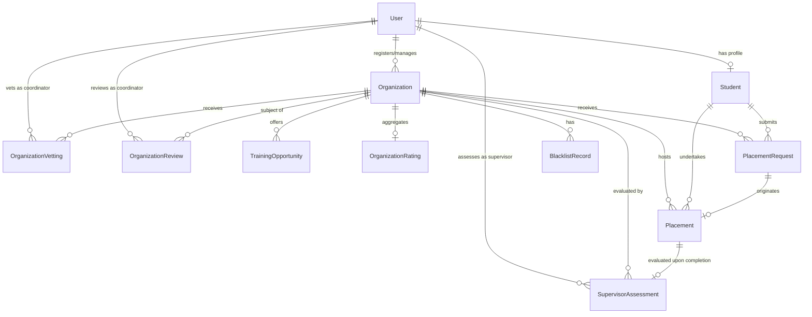
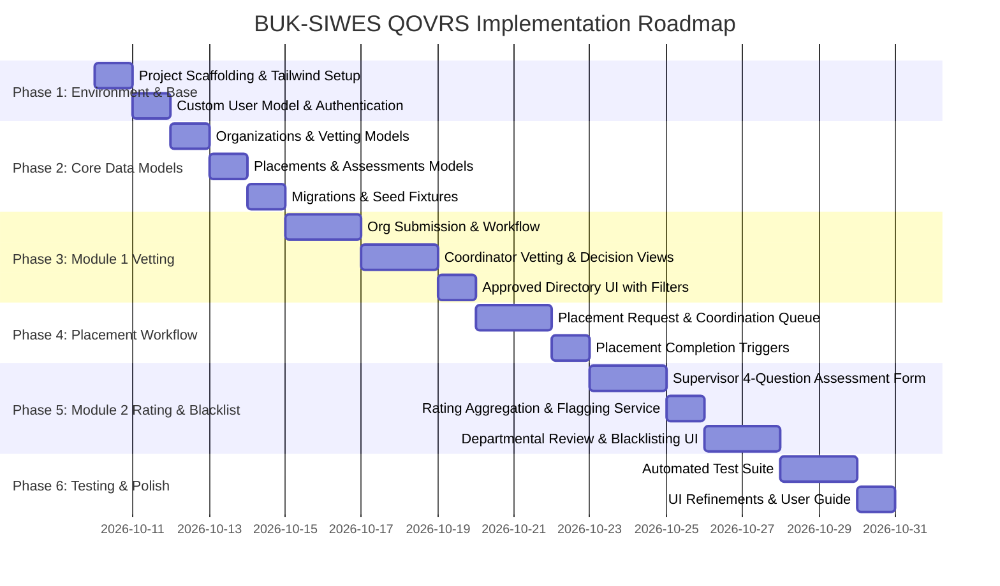

# SIWES Quality, Organization Vetting and Rating System (BUK-SIWES QOVRS)
## Detailed Fullstack Implementation Plan & Architecture Specification
**Department of Software Engineering, Bayero University Kano (BUK)**

---

## 1. Executive Summary & Project Foundation

### 1.1 Project Aim
To design and implement a SIWES Quality, Organization Vetting and Rating System (BUK-SIWES QOVRS) that supports the pre-placement assessment of host organizations and the post-placement evaluation of their training quality across a unified, closed-loop quality assurance pipeline.

### 1.2 Core Problem Solved
BUK, like most Nigerian universities, traditionally manages SIWES with no structured mechanism to:
1. **Pre-Placement:** Vet an organization's suitability before a student is placed there (preventing mismatch where students perform menial, unrelated tasks such as photocopying, running errands, or idle waiting).
2. **Post-Placement:** Capture and act on feedback about an organization's actual training quality after the placement ends.
3. **Institutional Accountability:** Overcome the complete absence of institutional memory, preventing organizations that provide low training value from repeatedly receiving student placements year after year.

### 1.3 Key Objectives Addressed
* **Objective i (Submission):** Enable organizations (and students/department) to submit organization details: name, address, industry/sector, services provided, and proposed training role.
* **Objective ii (Vetting):** Provide a departmental vetting workflow evaluating core business relevance to student curriculum and practical skill acquisition, backed by accumulated historical ratings.
* **Objective iii (Approved Directory):** Maintain a vetted, approved organization directory allowing students to browse and request placements exclusively from approved, non-blacklisted entities.
* **Objective iv (Post-Placement Assessment):** Implement a structured 4-dimension supervisor assessment: (1) Skill Relevance, (2) Supervision Adequacy, (3) Curriculum Alignment, and (4) Recommendation for Future Students.
* **Objective v (Rating Aggregation):** Implement organization-level rating aggregation (1–5 stars) maintaining running averages and full assessment history.
* **Objective vi (Low-Rating Flagging & Blacklisting):** Implement automatic flagging when an organization's rating falls below a defined departmental threshold (e.g., $< 3.0$ stars), triggering a formal departmental review workflow with outcomes (retaining approval, placing under monitoring, requiring further assessment, or blacklisting).
* **Objective vii (End-to-End Closed Loop Integration):** Seamlessly connect pre-placement vetting and post-placement evaluation so past performance directly regulates future placement permissions.

---

## 2. System Workflow & State Transitions

### 2.1 The 12-Stage Quality Control Pipeline
As defined in Chapter 3 (Section 3.2), the system operates across 12 distinct stages:



### 2.2 Organization Lifecycle State Machine
According to Chapter 3 (Section 3.4.4 & Figure 3.7):
The organization transitions through the following valid states:
1. `SUBMITTED`: Newly registered with proposed training opportunity; awaiting coordinator review.
2. `UNDER_REVIEW`: SIWES coordinator actively examining curriculum match and capacity.
3. `APPROVED`: Successfully vetted; active and available in the Approved Directory.
4. `REJECTED`: Failed vetting criteria; excluded from directory with documented coordinator reason.
5. `ACTIVE`: Actively hosting students in current placement cycle.
6. `FLAGGED`: Running star rating dropped below defined threshold ($< 3.0$); flagged automatically for review.
7. `REVIEWED`: Departmental review completed with decision logged (retain / monitor).
8. `BLACKLISTED`: Formally barred by department; permanently removed from student directory.

---

## 3. Technology Stack & Architectural Design

### 3.1 Technology Choices
* **Backend Framework:** Django (Python) — Model-View-Template (MVT) architecture, robust ORM, built-in authentication, form validation, and role-based access control.
* **Styling & Design System:** Tailwind CSS with Heroicons (SVG icons) — Responsive design styled according to Bayero University Kano corporate identity (Primary: Deep BUK Navy `#1E3A8A` / `#0F172A`, Accent: Academic Gold `#D97706` / Emerald `#059669`, Neutral: Slate `#F8FAFC` to `#0F172A`).
* **Interactive Components:** Vanilla JavaScript / Alpine.js (for reactive modals, dropdowns, dynamic search filters, and rating star selectors).
* **Database:** SQLite for initial local development/prototyping, fully compatible with PostgreSQL / MySQL for production deployment.

### 3.2 Layered System Architecture
1. **Presentation Layer (Templates & Tailwind UI):** Clean, role-segmented UI with high contrast, accessibility, BUK branding, flash notifications, and mobile responsiveness.
2. **Application / Business Logic Layer (Django Services & Forms):**
   * Role-based dispatch & authorization decorators.
   * Vetting engine & validation.
   * Rating aggregation & Bayesian/weighted average calculation.
   * Low-rating threshold detection & automated flagging listener.
   * Placement lifecycle state enforcement.
3. **Data Access Layer (Django ORM):** Optimized queries, foreign key constraints, indexes on lookup fields (`status`, `rating`, `student_id`, `org_id`).
4. **Database Layer:** Normalized relational schema enforcing all 11 core entities identified in Chapter 3.

---

## 4. Complete Database Schema & Entity Relationships

The schema directly implements all 11 entities specified in Chapter 3 (Section 3.5.3, Table 3.3, and Figure 3.10):



### 4.1 Detailed Data Models Specification

#### 1. `User` (Custom User Model extending `AbstractUser`)
* `id`: AutoField (Primary Key)
* `username`: CharField(150, unique=True)
* `email`: EmailField(unique=True)
* `first_name`: CharField(150)
* `last_name`: CharField(150)
* `role`: CharField(20, choices=[('COORDINATOR', 'SIWES Coordinator'), ('SUPERVISOR', 'Academic Supervisor'), ('STUDENT', 'Student'), ('ORGANIZATION', 'Organization Representative')])
* `phone_number`: CharField(20, blank=True)
* `created_at`: DateTimeField(auto_now_add=True)
* `is_active`: BooleanField(default=True)

#### 2. `Student`
* `id`: AutoField (Primary Key)
* `user`: OneToOneField(User, on_delete=CASCADE, related_name='student_profile')
* `registration_number`: CharField(30, unique=True) (e.g., `CST/20/SWE/00123`)
* `faculty`: CharField(100, default='Faculty of Computing')
* `department`: CharField(100, default='Software Engineering')
* `course_of_study`: CharField(100, default='B.Sc. Software Engineering')
* `level`: CharField(10, default='400L')
* `session`: CharField(20) (e.g., `2025/2026`)

#### 3. `Organization`
* `id`: AutoField (Primary Key)
* `name`: CharField(255, unique=True)
* `registration_number`: CharField(100, blank=True) (e.g. CAC RC Number)
* `industry_sector`: CharField(100) (e.g., Software Development, Telecommunications, FinTech, Public Sector IT)
* `services_provided`: TextField() (Detailed description of core business operations)
* `address`: TextField() (Physical corporate address)
* `city`: CharField(100, default='Kano')
* `state`: CharField(100, default='Kano')
* `website`: URLField(blank=True)
* `contact_person_name`: CharField(150)
* `contact_person_email`: EmailField()
* `contact_person_phone`: CharField(30)
* `status`: CharField(20, choices=[
    ('SUBMITTED', 'Submitted'),
    ('UNDER_REVIEW', 'Under Review'),
    ('APPROVED', 'Approved'),
    ('REJECTED', 'Rejected'),
    ('ACTIVE', 'Active'),
    ('FLAGGED', 'Flagged for Low Rating'),
    ('REVIEWED', 'Reviewed'),
    ('BLACKLISTED', 'Blacklisted')
  ], default='SUBMITTED')
* `created_by`: ForeignKey(User, on_delete=SET_NULL, null=True, related_name='created_organizations')
* `created_at`: DateTimeField(auto_now_add=True)
* `updated_at`: DateTimeField(auto_now=True)

#### 4. `TrainingOpportunity`
* `id`: AutoField (Primary Key)
* `organization`: ForeignKey(Organization, on_delete=CASCADE, related_name='training_opportunities')
* `role_title`: CharField(200) (e.g., Junior Software Engineering Intern)
* `role_description`: TextField() (Specific day-to-day training tasks and responsibilities)
* `expected_skills`: TextField() (Technical/engineering skills student will acquire)
* `curriculum_relevance_notes`: TextField(blank=True) (How this role aligns with Software Engineering curriculum)
* `slots_available`: PositiveIntegerField(default=1)
* `created_at`: DateTimeField(auto_now_add=True)

#### 5. `OrganizationVetting`
* `id`: AutoField (Primary Key)
* `organization`: ForeignKey(Organization, on_delete=CASCADE, related_name='vetting_records')
* `vetted_by`: ForeignKey(User, on_delete=SET_NULL, null=True, related_name='conducted_vettings')
* `decision`: CharField(20, choices=[('APPROVED', 'Approved'), ('REJECTED', 'Rejected'), ('NEEDS_CLARIFICATION', 'Needs Clarification')])
* `core_business_match_score`: PositiveSmallIntegerField(choices=[(1, 'Poor'), (2, 'Fair'), (3, 'Good'), (4, 'Very Good'), (5, 'Excellent')])
* `training_role_suitability_score`: PositiveSmallIntegerField(choices=[(1, 'Poor'), (2, 'Fair'), (3, 'Good'), (4, 'Very Good'), (5, 'Excellent')])
* `capacity_assessment`: TextField()
* `coordinator_comments`: TextField()
* `vetted_at`: DateTimeField(auto_now_add=True)

#### 6. `PlacementRequest`
* `id`: AutoField (Primary Key)
* `student`: ForeignKey(Student, on_delete=CASCADE, related_name='placement_requests')
* `organization`: ForeignKey(Organization, on_delete=CASCADE, related_name='placement_requests')
* `training_opportunity`: ForeignKey(TrainingOpportunity, on_delete=SET_NULL, null=True, blank=True)
* `proposed_start_date`: DateField()
* `proposed_end_date`: DateField()
* `cover_note`: TextField(blank=True)
* `status`: CharField(20, choices=[
    ('PENDING', 'Pending Departmental Approval'),
    ('ACCEPTED', 'Accepted & Approved'),
    ('REJECTED', 'Rejected by Coordinator'),
    ('CANCELLED', 'Cancelled by Student')
  ], default='PENDING')
* `coordinator_feedback`: TextField(blank=True)
* `created_at`: DateTimeField(auto_now_add=True)
* `updated_at`: DateTimeField(auto_now=True)

#### 7. `Placement`
* `id`: AutoField (Primary Key)
* `placement_request`: OneToOneField(PlacementRequest, on_delete=CASCADE, related_name='placement')
* `student`: ForeignKey(Student, on_delete=CASCADE, related_name='placements')
* `organization`: ForeignKey(Organization, on_delete=CASCADE, related_name='placements')
* `academic_supervisor`: ForeignKey(User, on_delete=SET_NULL, null=True, related_name='supervised_placements')
* `start_date`: DateField()
* `end_date`: DateField()
* `status`: CharField(20, choices=[
    ('ONGOING', 'Ongoing / Active'),
    ('COMPLETED', 'Completed'),
    ('TERMINATED', 'Terminated Early')
  ], default='ONGOING')
* `completion_date`: DateField(null=True, blank=True)
* `marked_completed_by`: ForeignKey(User, on_delete=SET_NULL, null=True, related_name='completed_placements')
* `created_at`: DateTimeField(auto_now_add=True)

#### 8. `SupervisorAssessment`
* `id`: AutoField (Primary Key)
* `placement`: OneToOneField(Placement, on_delete=CASCADE, related_name='assessment')
* `organization`: ForeignKey(Organization, on_delete=CASCADE, related_name='assessments')
* `academic_supervisor`: ForeignKey(User, on_delete=CASCADE, related_name='submitted_assessments')
* `q1_skill_relevance`: PositiveSmallIntegerField(choices=[(1, 'Strongly Disagree'), (2, 'Disagree'), (3, 'Neutral'), (4, 'Agree'), (5, 'Strongly Agree')], help_text="Did the student gain curriculum-relevant, practical skills rather than menial tasks?")
* `q2_supervision_adequacy`: PositiveSmallIntegerField(choices=[(1, 'Strongly Disagree'), (2, 'Disagree'), (3, 'Neutral'), (4, 'Agree'), (5, 'Strongly Agree')], help_text="Was the organization's technical industry supervision adequate and committed?")
* `q3_curriculum_alignment`: PositiveSmallIntegerField(choices=[(1, 'Strongly Disagree'), (2, 'Disagree'), (3, 'Neutral'), (4, 'Agree'), (5, 'Strongly Agree')], help_text="Was the training genuinely aligned with the departmental Software Engineering curriculum?")
* `q4_recommend_future`: PositiveSmallIntegerField(choices=[(1, 'Strongly Disagree'), (2, 'Disagree'), (3, 'Neutral'), (4, 'Agree'), (5, 'Strongly Agree')], help_text="Would you recommend this organization for future SIWES student placements?")
* `overall_rating`: DecimalField(max_digits=3, decimal_places=2, help_text="Calculated average of Q1-Q4 (scale 1.00 to 5.00)")
* `qualitative_feedback`: TextField(help_text="Detailed narrative of supervisor findings during assessment/visitation")
* `observed_student_tasks`: TextField(help_text="Types of tasks student actually performed during placement")
* `assessed_at`: DateTimeField(auto_now_add=True)

#### 9. `OrganizationRating`
* `id`: AutoField (Primary Key)
* `organization`: OneToOneField(Organization, on_delete=CASCADE, related_name='rating_summary')
* `total_assessments`: PositiveIntegerField(default=0)
* `average_rating`: DecimalField(max_digits=3, decimal_places=2, default=0.00)
* `avg_skill_relevance`: DecimalField(max_digits=3, decimal_places=2, default=0.00)
* `avg_supervision_adequacy`: DecimalField(max_digits=3, decimal_places=2, default=0.00)
* `avg_curriculum_alignment`: DecimalField(max_digits=3, decimal_places=2, default=0.00)
* `avg_recommendation`: DecimalField(max_digits=3, decimal_places=2, default=0.00)
* `last_calculated_at`: DateTimeField(auto_now=True)

#### 10. `OrganizationReview` (Organization Review / Flag)
* `id`: AutoField (Primary Key)
* `organization`: ForeignKey(Organization, on_delete=CASCADE, related_name='flag_reviews')
* `triggered_by_rating`: DecimalField(max_digits=3, decimal_places=2)
* `flag_reason`: TextField(default="Average supervisor assessment score fell below departmental minimum threshold of 3.00/5.00.")
* `flagged_at`: DateTimeField(auto_now_add=True)
* `status`: CharField(20, choices=[('PENDING', 'Pending Review'), ('REVIEWED', 'Reviewed & Resolved')], default='PENDING')
* `reviewed_by`: ForeignKey(User, on_delete=SET_NULL, null=True, blank=True, related_name='conducted_flag_reviews')
* `outcome`: CharField(30, choices=[
    ('RETAIN_APPROVAL', 'Retain Approval (Warning Issued)'),
    ('PLACE_ON_MONITORING', 'Place Under Formal Monitoring'),
    ('REQUIRE_FURTHER_ASSESSMENT', 'Require Further Assessment'),
    ('BLACKLIST', 'Blacklist Organization')
  ], null=True, blank=True)
* `review_notes`: TextField(blank=True)
* `resolved_at`: DateTimeField(null=True, blank=True)

#### 11. `BlacklistRecord`
* `id`: AutoField (Primary Key)
* `organization`: OneToOneField(Organization, on_delete=CASCADE, related_name='blacklist_record')
* `review`: ForeignKey(OrganizationReview, on_delete=SET_NULL, null=True, blank=True, related_name='blacklist_actions')
* `blacklisted_by`: ForeignKey(User, on_delete=SET_NULL, null=True, related_name='blacklisted_organizations')
* `reason`: TextField()
* `blacklisted_at`: DateTimeField(auto_now_add=True)
* `is_active`: BooleanField(default=True)

---

## 5. Django Project & Apps Architecture

The system is structured as a cohesive, production-grade Django project:
`src/qvrs` / project root: `qvrs_project/`

```
qvrs_project/
├── manage.py
├── qvrs_project/               # Core configuration
│   ├── __init__.py
│   ├── settings.py             # Settings (Tailwind, DB, Auth, Messages)
│   ├── urls.py                 # Master URL dispatcher
│   ├── wsgi.py
│   └── asgi.py
├── apps/
│   ├── accounts/               # Custom User, Authentication, Role Guards
│   │   ├── models.py           # User, Student
│   │   ├── forms.py            # LoginForm, RegistrationForm, ProfileForm
│   │   ├── views.py            # Login, Logout, Dashboard Dispatcher, Profiles
│   │   ├── decorators.py       # @coordinator_required, @supervisor_required, @student_required
│   │   └── urls.py
│   │
│   ├── organizations/          # Stages 1 to 4: Registration, Vetting, Directory
│   │   ├── models.py           # Organization, TrainingOpportunity, OrganizationVetting
│   │   ├── forms.py            # OrganizationSubmissionForm, TrainingOpportunityForm, VettingDecisionForm
│   │   ├── views.py            # OrgSubmitView, CoordinatorVettingQueueView, VettingDetailView, DirectoryListView, OrgDetailView
│   │   └── urls.py
│   │
│   ├── placements/             # Stages 5 to 7: Requests & Placement Tracking
│   │   ├── models.py           # PlacementRequest, Placement
│   │   ├── forms.py            # PlacementRequestForm, CoordinatorPlacementApprovalForm, MarkCompletedForm
│   │   ├── views.py            # StudentRequestPlacementView, CoordinatorPlacementQueueView, PlacementListView, MarkPlacementCompleteView
│   │   └── urls.py
│   │
│   ├── assessments/            # Stages 8 to 12: Assessments, Ratings, Flagging & Blacklisting
│   │   ├── models.py           # SupervisorAssessment, OrganizationRating, OrganizationReview, BlacklistRecord
│   │   ├── forms.py            # SupervisorAssessmentForm, DepartmentalReviewForm, BlacklistActionForm
│   │   ├── services.py         # RatingAggregationService, LowRatingDetectorService
│   │   ├── views.py            # SupervisorPendingQueueView, SubmitAssessmentView, CoordinatorFlaggedListView, ReviewFlaggedOrgView, BlacklistOrgView
│   │   └── urls.py
│   │
├── templates/                  # Tailwind CSS UI Templates
│   ├── base.html               # Master layout with BUK Navy Navbar, Flash messages, Footer
│   ├── components/             # Reusable partials (StarRating, StatusBadge, OrgCard, AlertBanner)
│   ├── accounts/               # Login, Student Signup, Dashboard views
│   ├── organizations/          # Submission form, Directory, Vetting review page, Org profile
│   ├── placements/             # Placement request modal/page, Student requests list, Coordinator queue
│   └── assessments/            # Supervisor assessment form, Org rating history, Flag review modal
└── static/
    ├── css/tailwind.css        # Tailwind compiled CSS / CDN configuration
    ├── js/main.js              # UI interactivity, star rating interactivity, confirmation modals
    └── img/buk_logo.png        # BUK Crest & emblem
```

---

## 6. End-to-End Business Logic & Automation Rules

### 6.1 Organization Vetting Rule (Stage 2 & 3)
* When an organization is submitted, it receives status `SUBMITTED`.
* A notification/badge appears on the Coordinator's dashboard: "Pending Vetting (N)".
* When vetting, the Coordinator scores:
  * Core business match: 1 to 5.
  * Training role suitability: 1 to 5.
  * Written feedback and capacity assessment.
* If **Approved**: Status becomes `APPROVED`, creating an empty `OrganizationRating` record (or preserving existing track record if an existing entity). Organization is automatically visible in the **Approved Organization Directory**.
* If **Rejected**: Status becomes `REJECTED`. Coordinator's refusal reason is recorded. The organization is barred from the directory.

### 6.2 Placement Request Gatekeeping (Stage 5)
* A student can only select from organizations that satisfy:
  $$\text{status} = \text{'APPROVED'} \quad \text{AND} \quad \text{status} \neq \text{'BLACKLISTED'}$$
* If a student attempts to tamper or request placement with a non-approved or blacklisted organization, Django validation raises `ValidationError("Placement requests can only be submitted to approved and non-blacklisted host organizations.")`.
* Students can view live status of their request: `PENDING`, `ACCEPTED`, or `REJECTED`.

### 6.3 Placement Completion & Assessment Trigger (Stage 7 & 8)
* Once the SIWES duration completes, the Coordinator (or Supervisor) marks the placement as `COMPLETED`.
* The system automatically generates a pending assessment entry for the assigned Academic Supervisor.
* Academic Supervisor dashboard highlights: "Pending Post-Placement Assessments (N)".

### 6.4 Rating Aggregation & Automatic Low-Rating Flagging (Stages 9 & 10)
Upon submission of a `SupervisorAssessment`:
1. Calculate overall assessment score:
   $$\text{Score} = \frac{Q_1 + Q_2 + Q_3 + Q_4}{4}$$
2. The `RatingAggregationService` runs atomically:
   * Recalculates running mean of all assessments for the organization:
     $$\bar{R} = \frac{\sum_{i=1}^N \text{Score}_i}{N}$$
   * Updates sub-dimension averages ($\bar{Q}_1, \bar{Q}_2, \bar{Q}_3, \bar{Q}_4$).
   * Updates `OrganizationRating` table.
3. Automatic Flagging Trigger:
   * If $\bar{R} < 3.00$ (defined departmental threshold) and organization status is not already `BLACKLISTED`:
     * Organization status is automatically updated to `FLAGGED`.
     * An `OrganizationReview` record is created with `status='PENDING'`, logging `triggered_by_rating`, timestamp, and automated audit note.
     * High-priority warning badge is displayed on the Coordinator's Command Center.

### 6.5 Departmental Review & Blacklisting Execution (Stages 11 & 12)
* The SIWES Coordinator inspects the flagged organization:
  * Reviews the full chronological assessment history, supervisor comments, and observed menial tasks.
* Coordinator chooses one of four formal outcomes:
  1. `RETAIN_APPROVAL`: Organization given formal warning; status updated to `REVIEWED` / `APPROVED`.
  2. `PLACE_ON_MONITORING`: Retained for current cycle under strict scrutiny.
  3. `REQUIRE_FURTHER_ASSESSMENT`: Secondary verification assigned.
  4. `BLACKLIST`:
     * Status updated to `BLACKLISTED`.
     * `BlacklistRecord` created with mandatory formal reason.
     * **Immediate exclusion:** Organization is automatically removed from the student-facing Approved Directory. No student can submit placement requests to it.

---

## 7. Comprehensive Page-by-Page Design, Layout, Content & Style

### 7.1 Global Styling & Design Tokens
* **Primary Color:** BUK Deep Navy (`#1E3A8A` / Tailwind `bg-blue-900`)
* **Primary Hover:** Indigo Navy (`#1E293B` / Tailwind `bg-slate-800`)
* **Secondary / Accent:** Academic Amber / Gold (`#D97706` / Tailwind `bg-amber-600`)
* **Success / Approved:** Emerald Green (`#059669` / Tailwind `bg-emerald-600`)
* **Warning / Flagged:** Amber / Orange (`#EA580C` / Tailwind `bg-orange-600`)
* **Danger / Blacklisted / Rejected:** Crimson Red (`#DC2626` / Tailwind `bg-red-600`)
* **Backgrounds:** Crisp slate-50 (`#F8FAFC`) with pure white card surfaces (`#FFFFFF`) and slate-200 borders (`#E2E8F0`).
* **Typography:** Clean Inter / sans-serif with bold hierarchical headers.

---

### 7.2 Page Specifications

#### Page 1: Landing / Public Home Page
* **Route:** `/`
* **Template:** `templates/pages/home.html`
* **Access:** Public (All visitors, students, staff, industry partners)
* **Header / Hero Section:**
  * BUK Crest & Department of Software Engineering banner.
  * Headline: *"SIWES Quality, Organization Vetting and Rating System (BUK-SIWES QOVRS)"*
  * Subtitle: *"Bridging classroom theory with verified industry training. Ensuring curriculum-relevant placements through proactive organization vetting and supervisor accountability."*
  * CTAs:
    * Primary Button: `[Browse Approved Organizations]` (Links to Directory)
    * Secondary Button: `[Register / Submit Organization]` (Links to Org Registration)
    * Tertiary Link: `[Sign In to Portal]` (Coordinator, Supervisor, Student login)
* **Value Pillars (3 Cards):**
  1. *Pre-Placement Vetting:* Proactive review of training roles before students accept offers. Filtering out menial jobs.
  2. *Supervisor Evaluation:* Post-placement assessment measuring real skill acquisition and curriculum alignment.
  3. *Institutional Quality Record:* Continuous rating and automatic blacklisting of exploitative or non-compliant firms.
* **Public Approved Directory Sneak Peek:** Top-rated vetted organizations with 4.5+ star badges.

---

#### Page 2: Authentication & Role Selection
* **Route:** `/accounts/login/` & `/accounts/register/student/`
* **Template:** `templates/accounts/login.html` & `templates/accounts/register_student.html`
* **Access:** Public / Unauthenticated
* **Content & Forms:**
  * Clean dual-column layout with BUK Navy background on left displaying institutional mission statement and secure login box on right.
  * Fields: Username / BUK Reg Number, Password, Role selector or automatic detection.
  * Registration link specifically for students requiring BUK Registration Number, Course of Study (`Software Engineering`), and Level (`400L`).

---

#### Page 3: Organization Submission Form (Stage 1)
* **Route:** `/organizations/submit/`
* **Template:** `templates/organizations/organization_submit.html`
* **Access:** Public / Organization Representative / Student submitting on behalf of firm
* **Purpose:** Allows an organization to submit details and proposed training role for departmental vetting.
* **Header:**
  * Title: *"Host Organization Registration & Training Role Proposal"*
  * Instructional Notice: *"All SIWES placement organizations must undergo vetting by the Department of Software Engineering before student placement requests can be approved. Please provide accurate details regarding your core business and the technical tasks the intern will undertake."*
* **Form Sections:**
  * **Section A: Organization Profile:**
    * Organization Name (e.g., `Kano Tech Hub Ltd`)
    * CAC RC Number / Registration ID
    * Industry / Sector (Dropdown: Software Development, Cyber Security, FinTech, Data Systems, Telecom, Hardware/Networking, Public Sector IT)
    * Physical Street Address, City, State
    * Official Website & Contact Person Details (Name, Phone, Work Email)
    * Services Provided (Detailed text area explaining core commercial operations)
  * **Section B: Proposed Training Role (Stage 1 Requirement):**
    * Role Title (e.g., `Junior Full-Stack Web Engineering Intern`)
    * Number of Placement Slots Available
    * Specific Day-to-Day Tasks (Text area: *"List the concrete engineering and professional activities the student will perform. Note: Non-technical tasks like photocopying or clerical errands are grounds for rejection."*)
    * Expected Technical Skills & Tools (e.g., Python, Django, Git, PostgreSQL, REST APIs)
    * Alignment with B.Sc. Software Engineering Curriculum
* **Submit Action:** Button: `[Submit for Departmental Vetting]`
* **Feedback:** Redirects to Submission Confirmation Page with unique reference ID.

---

#### Page 4: Organization Submission Status View
* **Route:** `/organizations/status/<int:org_id>/`
* **Template:** `templates/organizations/submission_status.html`
* **Access:** Organization Representative / Submitter
* **Content:**
  * Status Tracker with visual progression steps:
    * `[1] Submitted` $\rightarrow$ `[2] Departmental Vetting` $\rightarrow$ `[3] Decision: Approved / Rejected`
  * Summary card of submitted information.
  * Coordinator feedback box (if rejected, explains reasons such as "Mismatch between proposed tasks and Software Engineering curriculum").

---

#### Page 5: SIWES Coordinator Command Center (Dashboard)
* **Route:** `/coordinator/dashboard/`
* **Template:** `templates/coordinator/dashboard.html`
* **Access:** SIWES Coordinator only (`@coordinator_required`)
* **KPI Metrics Bar:**
  1. *Pending Organization Vettings:* (Count with Amber Badge)
  2. *Approved Directory Pool:* (Count with Green Badge)
  3. *Active Student Placements:* (Count with Blue Badge)
  4. *Flagged for Low Rating:* (Count with Red Pulsing Alert Badge)
* **Action Queues:**
  * **Tab 1: Urgent Flagged Organizations:** Table showing organizations with rating $< 3.00$ needing departmental review. Button: `[Convene Review]`.
  * **Tab 2: Pending Vetting Queue:** Newly submitted organizations waiting for review. Button: `[Review & Vet]`.
  * **Tab 3: Pending Placement Requests:** Student placement applications waiting for coordinator sign-off.
* **Quick Links:** Directory Manager, Full Rating History, Blacklist Registry.

---

#### Page 6: Coordinator Departmental Vetting Review Page (Stage 2 & 3)
* **Route:** `/coordinator/vetting/<int:org_id>/`
* **Template:** `templates/coordinator/vetting_detail.html`
* **Access:** SIWES Coordinator only
* **Content & Layout:**
  * **Left Column: Organization & Role Dossier:**
    * Company overview, sector, services provided.
    * Proposed training role, daily tasks, expected tools.
    * Past History Banner: If this organization previously hosted BUK students, display: *"Historical Track Record: X Students Placed, Average Supervisor Rating: 4.2 / 5.0 (Vetted previously in 2024/2025)"* or *"First-time applicant: No prior BUK history."*
  * **Right Column: Departmental Vetting Form:**
    * Rubric Item 1: Core Business Relevance to Software Engineering (1 = Irrelevant, 5 = Highly Relevant).
    * Rubric Item 2: Proposed Training Role Suitability & Real-world Skills (1 = Low/Menial, 5 = Genuine Technical Practice).
    * Rubric Item 3: Institutional Training Capacity Assessment.
    * Coordinator Comments & Rationale (Mandatory text area).
    * Action Decision Buttons:
      * Green Button: `[Approve Organization & Add to Directory]`
      * Red Button: `[Reject Organization (Document Mismatch)]`

---

#### Page 7: Approved Organization Directory (Stage 4)
* **Route:** `/directory/`
* **Template:** `templates/directory/approved_list.html`
* **Access:** Authenticated Students, Staff, Public
* **Purpose:** The centralized catalog of vetted organizations where students can browse and apply. **Blacklisted and unapproved organizations are strictly excluded.**
* **Filters & Search Header:**
  * Search input: Name, keyword, or technologies.
  * Filter by Industry Sector (Software, FinTech, Telecom, etc.).
  * Filter by Star Rating (All, 4+ Stars, 3+ Stars).
  * Sort by: Highest Rated, Alphabetical, Most Recent.
* **Organization Cards Grid:**
  * Card Header: Organization Name + City/State + Industry Sector badge.
  * Star Rating Display: Visual 1–5 Gold Stars + Numerical score (e.g., `★ 4.65 / 5.00` based on `6 supervisor evaluations`) or *"Newly Approved — No Placements Yet"*.
  * Training Opportunity Snapshot: Role Title (e.g. *"Python/Django Backend Intern"*) + Slots Available.
  * Action Button:
    * For Students: `[View Details & Request Placement]`
    * For Coordinators: `[Manage Record]`

---

#### Page 8: Organization Detail & Quality Track Record
* **Route:** `/directory/<int:org_id>/`
* **Template:** `templates/directory/org_detail.html`
* **Access:** Authenticated Users
* **Content:**
  * Full organization biography, address, website, verified status badge.
  * Available Training Opportunities & detailed task descriptions.
  * **Quality Track Record Section (Aggregated Supervisor History):**
    * Overall Running Star Rating: Big display (e.g. `4.4 / 5.0 ★★★★☆`).
    * Breakdown of the 4 Assessment Dimensions:
      1. Skill & Practical Training Relevance: `88%`
      2. Adequacy of Technical Supervision: `85%`
      3. Curriculum Alignment with Software Engineering: `90%`
      4. Recommendation for Future Students: `92%`
    * Past Placement Count: e.g. `8 Completed Placements`.
    * (Anonymized Supervisor Qualitative Insights for departmental transparency).
  * Action: `[Apply for Placement Here]` (triggers placement request form).

---

#### Page 9: Student Placement Request Submission (Stage 5)
* **Route:** `/placements/request/<int:org_id>/`
* **Template:** `templates/placements/request_form.html`
* **Access:** Student only (`@student_required`)
* **Validation Guard:** If organization status is not `APPROVED` or is `BLACKLISTED`, abort with an error page: *"Placement cannot be requested for this organization."*
* **Form Fields:**
  * Selected Organization (Read-only verified badge).
  * Selected Training Opportunity (Dropdown from organization's approved roles).
  * Proposed SIWES Start Date & End Date (Datepickers adhering to academic calendar).
  * Student Statement / Cover Note: Why this placement aligns with the student's SIWES training plan.
* **Submit Action:** Button: `[Submit Placement Request for Departmental Approval]`

---

#### Page 10: Student Placement Portal / Status Tracker
* **Route:** `/student/my-placements/`
* **Template:** `templates/student/placement_history.html`
* **Access:** Student only
* **Content:**
  * Active Placement Status Banner:
    * If `PENDING`: *"Your request to [Org Name] is currently awaiting SIWES Coordinator review."*
    * If `ACCEPTED`: *"Placement approved! Active from [Start Date] to [End Date]. Assigned Academic Supervisor: Dr. Usman (Software Engineering Dept)."*
    * If `REJECTED`: Shows coordinator feedback and button `[Browse Other Approved Organizations]`.
    * If `COMPLETED`: *"SIWES placement completed on [End Date]. Post-placement quality evaluation has been handed over to your academic supervisor."*

---

#### Page 11: Academic Supervisor Assessment Portal (Stage 8)
* **Route:** `/supervisor/assessments/` & `/supervisor/assessments/<int:placement_id>/`
* **Template:** `templates/supervisor/assessment_form.html`
* **Access:** Assigned Academic Supervisor only (`@supervisor_required`)
* **Pending Placements List:** Shows students who have completed SIWES with host organizations, pending supervisor sign-off.
* **Structured Assessment Form (The 4 Core Questions):**
  * Placement Context Card: Student Name, Reg Number, Host Organization, Internship Role, Placement Period.
  * **Dimension 1: Skill Relevance & Practical Training**
    * Question: *"Did the student gain curriculum-relevant, practical skills rather than menial, unrelated tasks (e.g., photocopying, running errands, idle waiting)?"*
    * Rating Scale: 1 (Strongly Disagree) to 5 (Strongly Agree) interactive radio stars.
  * **Dimension 2: Organization Supervision Adequacy**
    * Question: *"Was the organization's technical industry supervision adequate, committed, and constructive?"*
    * Rating Scale: 1 (Strongly Disagree) to 5 (Strongly Agree).
  * **Dimension 3: Curriculum Alignment**
    * Question: *"Was the training genuinely aligned with the departmental Software Engineering curriculum?"*
    * Rating Scale: 1 (Strongly Disagree) to 5 (Strongly Agree).
  * **Dimension 4: Recommendation for Future Students**
    * Question: *"Would you recommend this organization for future BUK Software Engineering students?"*
    * Rating Scale: 1 (Strongly Disagree) to 5 (Strongly Agree).
  * **Qualitative Field: Observed Student Tasks**
    * Text area: *"Detail the specific tasks and engineering projects the student actually worked on."*
  * **Qualitative Field: Supervisor Findings & Narrative**
    * Text area: *"General comments on host organization commitment, facilities, and mentorship."*
* **Submit Action:** Button: `[Submit Official Assessment & Update Organization Quality Record]`
* **System Action upon submission:** Triggers `RatingAggregationService`, recalculates organization stars, and evaluates low-rating flagging condition.

---

#### Page 12: Low-Rating Flag Review & Departmental Hearing (Stage 10 & 11)
* **Route:** `/coordinator/reviews/<int:review_id>/`
* **Template:** `templates/coordinator/flag_review_detail.html`
* **Access:** SIWES Coordinator only
* **Urgent Notice Banner:**
  * Alert: *"AUTOMATIC LOW-RATING FLAG TRIGGERED — Departmental Quality Review Required"*
  * Reason: *"Organization's cumulative rating has dropped to [2.25 / 5.00], which is below the departmental quality threshold of 3.00."*
* **Full Evidence Dossier:**
  * Chronological table of all supervisor assessments with individual scores for Q1, Q2, Q3, Q4.
  * Supervisor excerpts documenting menial tasks or lack of supervision.
* **Departmental Review Form:**
  * Review Session Date & Departmental Committee Notes.
  * **Formal Decision Radio Group (Stage 11 Outcomes):**
    1. `Retain Approval`: Issue formal warning to firm, maintain in directory under observation.
    2. `Place Under Formal Monitoring`: Require midterm supervisor inspection for next cohort.
    3. `Require Further Assessment`: Withhold decision pending departmental committee inquiry.
    4. `Blacklist Organization`: Remove immediately from Approved Directory and bar from future placements.
* **Submit Action:** Button: `[Finalize Departmental Decision]`

---

#### Page 13: Departmental Blacklist Registry (Stage 12)
* **Route:** `/coordinator/blacklist/`
* **Template:** `templates/coordinator/blacklist_registry.html`
* **Access:** SIWES Coordinator & Departmental Staff
* **Content:**
  * Table of all blacklisted organizations.
  * Columns: Organization Name, Sector, Date Blacklisted, Final Rating, Formal Blacklist Reason, Blacklisted By.
  * Status indicator: `PERMANENTLY EXCLUDED FROM DIRECTORY`.
  * Audit log link for departmental quality assurance compliance.

---

## 8. Step-by-Step Implementation Roadmap



### Phase 1: Project Setup & User Authentication
1. Initialize Django project within `qvrs/` directory.
2. Install required dependencies: `django`, `django-tailwind` (or Tailwind standalone CLI), `pillow` (for logo/images).
3. Implement `accounts` app with custom `User` model, role choices (`COORDINATOR`, `SUPERVISOR`, `STUDENT`, `ORGANIZATION`), and `Student` profile model.
4. Build base template (`base.html`) using Tailwind CSS with BUK institutional color palette, responsive navigation, flash messaging, and auth status.
5. Create authentication views: Login, Student Registration, Logout, and role-based redirect dashboard.

### Phase 2: Database Modeling & Admin Integration
1. Implement `organizations` models (`Organization`, `TrainingOpportunity`, `OrganizationVetting`).
2. Implement `placements` models (`PlacementRequest`, `Placement`).
3. Implement `assessments` models (`SupervisorAssessment`, `OrganizationRating`, `OrganizationReview`, `BlacklistRecord`).
4. Register all models in Django Admin with customized tabular inlines, list filters, search fields, and color-coded status badges for administration.
5. Run migrations and create a comprehensive seed fixture (`initial_seed.json`) providing mock BUK Software Engineering students, coordinators, supervisors, vetted tech firms (e.g. Kano Tech Hub, NITDA Hub, Galaxy Backbone), and completed placements.

### Phase 3: Module 1 — Pre-Placement Organization Vetting & Approved Directory
1. Build `OrganizationSubmissionForm` & `TrainingOpportunityForm` capturing organization profile, core business, technical roles, and curriculum alignment notes.
2. Develop public submission view and submitter tracking view.
3. Build Coordinator Vetting Queue and Vetting Detail View with interactive rubrics for scoring business relevance and role suitability.
4. Implement vetting actions: Approve (moves org to `APPROVED` and injects into Directory) or Reject (moves to `REJECTED` with feedback).
5. Build the **Approved Organization Directory** view with dynamic search, sector filtering, star ratings, and detail modal/pages. Strictly enforce exclusion of unapproved or blacklisted firms.

### Phase 4: Placement Request & Lifecycle Tracking
1. Build `PlacementRequestForm` allowing students to pick an approved organization and role, entering proposed dates and cover note.
2. Implement strict backend validation preventing requests to unapproved or blacklisted organizations.
3. Build Coordinator Placement Management Queue to accept or reject placement applications.
4. Build Placement tracking model where accepted requests become active `Placement` records.
5. Build completion trigger allowing Coordinator or Supervisor to mark placement as `COMPLETED`.

### Phase 5: Module 2 — Post-Placement Supervisor Assessment, Rating Aggregation & Blacklisting
1. Build the **Supervisor Assessment Portal**: Listing completed placements assigned to the logged-in academic supervisor.
2. Build the structured 4-question assessment form (1 to 5 scale for Skill Relevance, Supervision Adequacy, Curriculum Alignment, Future Recommendation + qualitative task log).
3. Implement `RatingAggregationService`: Automatically recalculates running averages and total assessment count upon assessment submission.
4. Implement `LowRatingDetectorService`: Automatically checks if running average $< 3.00$. If true, transitions organization status to `FLAGGED` and creates an `OrganizationReview` instance.
5. Build Coordinator Flagged Organizations Review Center: Displays audit dossier, supervisor evaluations, and review options (Retain Approval, Monitor, Blacklist).
6. Build Blacklisting execution logic: Permanently transitions status to `BLACKLISTED`, writes `BlacklistRecord`, and purges organization from the Approved Directory.
7. Build Blacklist Registry page showing history of all blacklisted organizations and reasons.

### Phase 6: System Verification, Unit Testing & Final Polish
1. Unit tests for models and state transitions.
2. Integration tests for closed-loop quality pipeline:
   * Verify an unapproved organization cannot receive placement requests.
   * Verify supervisor assessment updates running star ratings accurately.
   * Verify low ratings automatically trigger review flags.
   * Verify blacklisting completely removes organization from student directory.
3. UI refinement with Tailwind CSS, ensuring smooth mobile responsiveness and BUK branding integrity.

---

## 9. Conclusion
This implementation plan strictly adheres to all specifications and use cases detailed in Chapter 3 of the project documentation. It translates every documented requirement into concrete Django models, views, forms, templates, and business logic services, providing a clear and comprehensive path to delivering the BUK-SIWES QOVRS platform.
